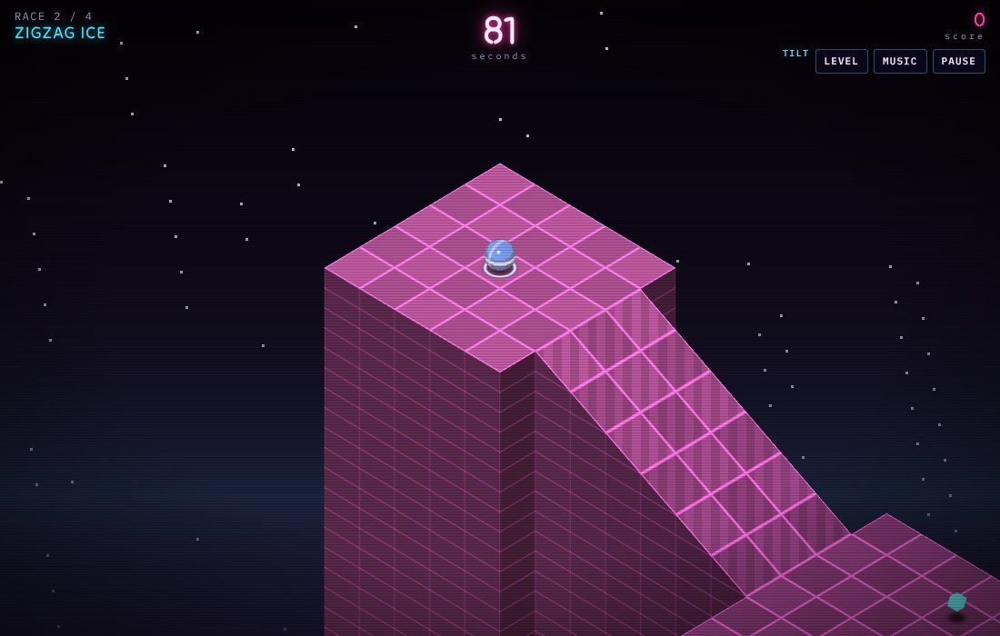

# Tiltgrid '84

A browser game: roll a glass marble down four isometric courses of neon tiles before a shared clock runs out. It is a new game in the genre that Atari's *Marble Madness* started in 1984, made with 2026 browser features: it draws with WebGPU, steers from the phone's tilt sensor (or touch, keys or a gamepad), and plays an original chiptune score that it sequences live in Web Audio on the kinds of voices 1980s sound chips had (pulse waves, a triangle wave and noise). The courses, music, art and name are new; none are copied from that game.

**Play:** [austegard.com/games/tiltgrid/](https://austegard.com/games/tiltgrid/). It needs a browser with WebGPU: a current Chrome or Edge, Safari 26 or later, or Firefox 141 or later on Windows. Without WebGPU the page says so and the start button stays disabled. Tilt works in a phone browser; iOS asks for motion permission when you press *Insert coin*.



## How it plays

Distances below are in tiles: one floor tile is 1 unit across, and the stripes on a wall are half a unit apart.

- **Four races, one clock.** Each race adds time (45, 40, 40 and 45 s), and the seconds you have left carry into the next race. Cyan diamonds add 6 s. Below 10 s the clock ticks and the music speeds up. At 0 s the game ends with *Time up* and you start again from race 1.
- **Score.** Finishing race *n* is worth 1,000 × *n*; each diamond is worth 250; finishing all four adds 100 per second left on the clock. The best score is kept in the browser.
- **Falls.** Ramps are safe. Landing after a drop of more than 2.4 units (about five wall stripes) shatters the marble, and rolling off the edge of the course into the empty space around it loses the marble. Either way the clock keeps running and the marble comes back on the last tile where it was safe to stop: a flat tile with flat, solid, acid-free tiles on all four sides, crossed at under 7 units/s. Tiles within 1.8 units of a sweeper's lane or 2.5 units of a chaser's starting post never count as safe, and for 1.4 s after a respawn, while the marble blinks, sweepers and chasers pass through it.
- **Floors.** Acid (green, rippling) dissolves the marble. On ice (pale blue) your steering has 30% of its normal force and the marble barely slows down by itself. Yellow chevrons push at 10 units/s². Your own steering pushes at 12.5 on ordinary floor, so you can hold your line against a sideways chevron on a narrow bridge.
- **Opponents.** Black glass spheres with a magenta eye chase you when you are within 7 units and on their level. They are 1.6 times as heavy as your marble, so a collision moves you more than them. Orange striped blocks sweep back and forth across lanes and bridges and bat you aside.

## Controls

| Input | How |
|---|---|
| Phone tilt | Tilt toward where you want to roll. The angle you hold at the start of each race counts as level. Once the page has seen the tilt sensor a **Level** button appears; it (or C) makes the current angle level. About 16° of tilt is full speed. |
| Touch or mouse | Press and drag anywhere: a stick appears under the finger. |
| Keys | Arrows or WASD. Enter or Space starts; P or Esc pauses; M mutes the music. |
| Gamepad | Left stick. Start or A begins a game from the title or end screen; Start pauses during a race. |

## How it is built

One HTML file, no libraries.

- **Courses** are grids of cells, and each cell stores the heights of its four corners. A ramp is a cell whose corners differ; a ledge is a jump in height between neighbouring cells. Each course is written as 8 to 14 calls such as `plat` and `rampZ` (`COURSES` in `index.html`), and one pass turns the grid into tile tops and walls for the GPU.
- **Physics** advances in steps of at most 1/240 s, up to eight per drawn frame. On the ground, gravity pulls the marble along the slope of the surface under it, and the game finds a wall by checking the height of the surface just ahead of the marble on each axis. In the air the marble falls freely and remembers the highest point it reached since it left the ground; the landing compares that point with the floor to decide whether the drop was lethal.
- **Rendering** is one WGSL shader, an orthographic camera looking down at the course from one corner, and 4× multisampling. The fragment shader draws each tile's grid lines, chevrons, acid ripple and chequered finish. Each marble, chaser and sweeper casts a soft round shadow, which the floor shader computes from the positions of up to eight bodies.
- **Tilt** reads gravity's direction instead of the raw angles from the sensor: the downhill direction across the screen is `(cos β sin γ, −sin β)` in the phone's own axes. The game subtracts the direction it read at the start of the race and rotates the result by `screen.orientation.angle`.
- **Music** is an original piece in A minor at 138 beats a minute, in the order intro, verse, bridge, verse, then looped. A pulse wave with a 25% duty cycle plays the lead, with vibrato that fades in on long notes; a 12.5% pulse plays arpeggios; a triangle wave plays the bass, jumping an octave on every other eighth note; and a noise channel, which holds each random sample for three output samples, plays the drums. A low-pass filter at 7.8 kHz dulls the mix the way a small cabinet speaker would. The sound effects use the same voices. The rolling sound is noise through a band-pass filter whose level and pitch rise with the marble's speed.

## Checks

`tests/check.mjs` opens the page in headless Chromium with SwiftShader, a software WebGPU, and checks 12 things. All 12 passed on the last run:

- the shader compiles, frames render, and the console shows no errors or warnings;
- the arrow keys move the marble toward the bottom of the screen;
- a synthetic `deviceorientation` event turns tilt on;
- a scripted driver that steers through waypoints reaches the finish of all four courses with the game's own physics, in 12 to 23 s against time budgets of 40 to 45 s. It holds its own speed to 4.5 units/s; the marble's top speed in the game is 11.5;
- no respawn tile lies in a sweeper's lane;
- rolling off the course kills the marble, and it comes back;
- a 4-unit fall shatters it;
- the music sequencer advances.

```bash
NODE_PATH=$(npm root -g) node games/tiltgrid/tests/check.mjs /tmp/tiltgrid-check
```

SwiftShader draws about 8.5 frames a second, and the game counts at most 0.05 s of game time per frame, so on SwiftShader the game runs slower than real time. The checks therefore wait for the game's state to change, not for a fixed number of seconds.

Not tested: real phones (how tilt feels, the iOS permission prompt, frame rate), WebGPU in Safari and Firefox, and whether a person can beat the clock. The scripted driver shows that each course can be finished, not that it is fair.
